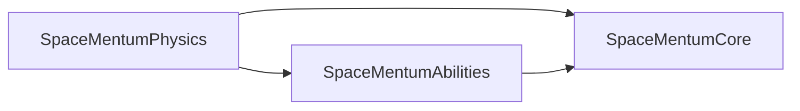

# SpaceMentum — Technical Specifications
**Version:** 0.1.0 (Step 1 scaffold) · **Engine:** Unreal Engine 5.8 · **Companion to:** [GAME_DESIGN_DOCUMENT.md](../GAME_DESIGN_DOCUMENT.md)

> **Creator's voice:** *"it is a rule to add my emotions, likings, reasonings, quotes too in all documentations .mds, docstrings, comments, everywhere so we never deviate from my feels."*
> This document explains *how* the code is built. The GDD explains *why*. Read both.

---

## 1. Module Map

| Module | Role | Feeling it protects |
| :--- | :--- | :--- |
| `SpaceMentumPhysics` | Orbit math, momentum kick, forward drift, trajectory solver | *"it has physics."*: heavy, punchy, deterministic |
| `SpaceMentumAbilities` | Data assets (maces, abilities, obstacles) + ability bridge | *"abilities and obsticles through time with flavour"* |
| `SpaceMentumCore` (**primary**) | Game mode, game state, player controller, astronaut, camera | *"a space person zooming in the forward direction"* |

## 2. Dependency Graph (acyclic, enforced in `*.Build.cs`)

**Rules**
- Physics depends on **no** game module, so the feel can be tuned and unit-tested on its own.
- Abilities may depend on Physics (data assets embed physics tuning structs). It must never depend on Core.
- Core composes everything. New gameplay features go in the lowest module that can own them.

## 3. Coordinate & Math Conventions

| Symbol (GDD) | Unreal axis / unit | Notes |
| :--- | :--- | :--- |
| Forward drift `v_z` | **+X**, cm/s | Constant; never altered by the kick |
| Lateral dodge `v_x, v_y` | **+Y right, +Z up**, cm/s | Produced only by the momentum kick |
| Orbit plane | Astronaut-local **YZ** | Full 360° cylindrical orbit (decided at the Step 1 kickoff) |
| Orbit angle `θ` | radians, 0 = +Y | Positive = counter-clockwise **as seen from the chase camera** |
| Tangent `v_t = ω × r` | `FTrajectoryPredictor::ComputeTangentDirection` × `ω·r` | Implemented and tested in Step 2 |
| Kick `J = ±α·m_m·v_t` | `EMomentumKickModel` picks the sign | ⚠️ Open feel question; see PROGRESS.md |

## 4. Input Specification

> *"for pc A and D looks good. only two buttons for now to spin the mace, moment of stopping is the moment of release. everything can be controles by this i think."*

| Action | Type | PC | Mobile (if chosen) | Effect |
| :--- | :--- | :--- | :--- | :--- |
| `IA_SpinCounterClockwise` | bool (hold) | **A** | Left-thumb hold zone | Wind mace CCW |
| `IA_SpinClockwise` | bool (hold) | **D** | Right-thumb hold zone | Wind mace CW |
| `IA_ToggleKickModel` | bool (trigger) | **M** | Optional debug button | Toggle ReactionRecoil vs CarryAlong |
| *(release, nothing held)* | n/a | let go | lift thumb | Mace stops → momentum kick fires |

- **Both held at once (SOCD Resolution):** Locked as **Last-Input-Priority with fallback to held**. If A is held and D is tapped, the spin immediately flips to Clockwise; when D is released, it seamlessly falls back to Counter-Clockwise without dropping the spin. When both are released, the kick fires immediately.
- Procedural Enhanced Input actions and mapping context (`IMC_SpaceDiving_Procedural`) are generated directly in C++ if editor assets are not yet assigned.

## 5. Physics, Determinism & Tooling

- `DefaultGravityZ = 0`: deep space zero gravity.
- Chaos substepping at **1/120 s**, up to 8 substeps. This keeps the fast mace head from tunnelling through thin obstacles.
- `bEnableEnhancedDeterminism = True` for replays, ghost runs, and leaderboard validation.
- Orbit and kick state are plain `USTRUCT`s (`FMaceOrbitState`, `FMaceTelemetry`, `FTrajectoryPoint`).
- **Closed-Form Trajectory Prediction:** Analytical integration in `FTrajectoryPredictor::PredictTrajectoryCurve` projects the astronaut's flight path over a discrete horizon (e.g. 1.5s) without frame-rate dependent error.
- **Real-Time Debug Visualizer (`FSpaceMentumDebugVisualizer`):**
  - Orbit ring in local YZ.
  - Speed-reactive mace head sphere and tether cable.
  - Tangential velocity vector arrow (yellow).
  - Instantaneous kick direction preview arrow (green).
  - Projected flight path curve through the forward corridor (cyan).
  - Live on-screen HUD telemetry lines displaying RPM, speed, angle, and active kick model.

## 5.1 Dynamic Flight Camera Rig (`USpaceFlightCameraComponent`)

- **Speed-Reactive FOV Dilation:** Smooth asymptotic expansion from base $80^\circ$ up to $105^\circ$ as forward velocity climbs to $3600\text{ cm/s}$ ($130\text{ km/h}$).
- **Spring Arm Length Dilation:** Pulls camera back by up to $+120\text{ cm}$ at hyperspace velocities to maintain forward corridor visibility.
- **Dynamic Dutch Roll Banking:** Automatically banks the camera ($\pm 4.5^\circ$) in response to lateral whiplash evasion kicks ($v_y, v_z$).
- **Non-Linear Kinetic Screen Shake:** Power-law trauma model ($Shake = Trauma^2$) on obstacle impacts and asteroid launch thrust.

## 5.2 Multi-System Niagara Particle Pipeline (`USpaceFlightVFXComponent`)

- **`NS_MacePlasmaTrail`:** Speed-reactive ribbon emitter attached to the mace head; dynamic parameter `User.RibbonColor` shifts from electric cyan (`#00f5d4`) at low spin to supersonic magenta (`#f72585`) at 3.0 rev/s.
- **`NS_HyperspaceDust`:** Directional velocity streaks aligned inversely with velocity vector $\vec{v}$; spawn rate dynamically scales with linear speed ($180 \to 650\text{ particles/s}$).
- **`NS_KineticImpactBurst`:** High-energy directional spark/plasma burst spawned at obstacle contact point $\vec{x}_{\text{impact}}$ along collision normal $\vec{n}$.
- **`NS_LaunchExhaustBurst`:** Directional pneumatic decompression jet fired against the starting asteroid anchor during launch departure.

## 5.3 Procedural Audio & Metasounds (`USpaceProceduralFlightAudioComponent`)

- **Continuous Pitch-Tracking Oscillator:** Maps angular velocity $\omega$ ($0 \to 18.85\text{ rad/s}$) to audio pitch ($85\text{ Hz} \to 640\text{ Hz}$).
- **Rotational Energy Volume Scaling:** Modulates sound loudness with rotational kinetic energy ($E_{\text{rot}} = \frac{1}{2} I \omega^2$).
- **Sub-Bass Launch Thump:** Resonant 45Hz sub-bass transient when the starting asteroid hydraulic ram releases.
- **Cosmic Wind Drag:** Velocity-filtered noise simulation for micro-particle hull friction.

## 6. Coding Standard

1. **File headers** carry `@file`, `@brief`, `@creator_feel` (a verbatim quote), and `@emotional_intent` (GDD §0.2).
2. **Comments explain the feeling behind a number**, not only the arithmetic: `// 1080 deg/s = 3 rev/s: fast, but still readable.`
3. **Filenames** follow the UE convention: no `U`/`A` prefix (`MaceOrbitComponent.h` → `UMaceOrbitComponent`).
4. **Tuning lives in data**: `USTRUCT` feel knobs, set through `UMaceDefinitionDataAsset`. Never hard-code a feel value inside logic.
5. **UFUNCTION getters return by value.**
6. **Components own one responsibility each.** The astronaut is only a composition root.
7. **Soft references** (`TSoftObjectPtr`) for meshes and VFX inside data assets.

## 7. Folder Layout

Matches GDD §4. The only differences: source filenames drop the `U`/`A` prefix, and `PROGRESS.md` at the repo root is the live hand-off log.
