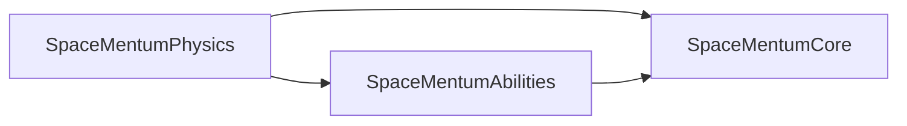

# SpaceMentum — Technical Specifications
**Version:** 0.1.0 (Step 1 scaffold) · **Engine:** Unreal Engine 5.8 · **Companion to:** [GAME_DESIGN_DOCUMENT.md](../GAME_DESIGN_DOCUMENT.md)

> **Creator's voice:** *"it is a rule to add my emotions, likings, reasonings, quotes too in all documentations .mds, docstrings, comments, everywhere so we never deviate from my feels."*
> This document explains *how* the code is built. The GDD explains *why*. Read both.

---

## 1. Module Map

| Module | Role | Feeling it protects |
| :--- | :--- | :--- |
| `SpaceMentumPhysics` | Orbit math, momentum kick, forward drift, trajectory solver | *"it has physics."*: heavy, punchy, deterministic |
| `SpaceMentumAbilities` | Data assets (maces, abilities, obstacles) + ability bridge | *"abilities and obsticles through time with flavour"* |
| `SpaceMentumCore` (**primary**) | Game mode, game state, player controller, astronaut, camera | *"a space person zooming in the forward direction"* |

## 2. Dependency Graph (acyclic, enforced in `*.Build.cs`)

**Rules**
- Physics depends on **no** game module, so the feel can be tuned and unit-tested on its own.
- Abilities may depend on Physics (data assets embed physics tuning structs). It must never depend on Core.
- Core composes everything. New gameplay features go in the lowest module that can own them.

## 3. Coordinate & Math Conventions

| Symbol (GDD) | Unreal axis / unit | Notes |
| :--- | :--- | :--- |
| Forward drift `v_z` | **+X**, cm/s | Constant; never altered by the kick |
| Lateral dodge `v_x, v_y` | **+Y right, +Z up**, cm/s | Produced only by the momentum kick |
| Orbit plane | Astronaut-local **YZ** | Full 360° cylindrical orbit (decided at the Step 1 kickoff) |
| Orbit angle `θ` | radians, 0 = +Y | Positive = counter-clockwise **as seen from the chase camera** |
| Tangent `v_t = ω × r` | `FTrajectoryPredictor::ComputeTangentDirection` × `ω·r` | Implemented and tested in Step 2 |
| Kick `J = ±α·m_m·v_t` | `EMomentumKickModel` picks the sign | ⚠️ Open feel question; see PROGRESS.md |

## 4. Input Specification

> *"for pc A and D looks good. only two buttons for now to spin the mace, moment of stopping is the moment of release. everything can be controles by this i think."*

| Action | Type | PC | Mobile (if chosen) | Effect |
| :--- | :--- | :--- | :--- | :--- |
| `IA_SpinCounterClockwise` | bool (hold) | **A** | Left-thumb hold zone | Wind mace CCW |
| `IA_SpinClockwise` | bool (hold) | **D** | Right-thumb hold zone | Wind mace CW |
| *(release, nothing held)* | n/a | let go | lift thumb | Mace stops → momentum kick |

- Both held at once: **TBD in Step 2.** Proposal: the most recently pressed button wins.
- Step 2 creates the actions and mapping context in C++, so no editor assets are needed yet. Once the editor is in use they get mirrored as assets in `Content/Core/Input/`.

## 5. Physics & Determinism

- `DefaultGravityZ = 0`: deep space.
- Chaos substepping at **1/120 s**, up to 8 substeps. This keeps the fast mace head from tunnelling through thin obstacles.
- `bEnableEnhancedDeterminism = True` for replays, ghost runs, and leaderboard validation.
- Orbit and kick state are plain `USTRUCT`s (`FMaceOrbitState`) so they can be recorded.

## 6. Coding Standard

1. **File headers** carry `@file`, `@brief`, `@creator_feel` (a verbatim quote), and `@emotional_intent` (GDD §0.2).
2. **Comments explain the feeling behind a number**, not only the arithmetic: `// 1080 deg/s = 3 rev/s: fast, but still readable.`
3. **Filenames** follow the UE convention: no `U`/`A` prefix (`MaceOrbitComponent.h` → `UMaceOrbitComponent`).
4. **Tuning lives in data**: `USTRUCT` feel knobs, set through `UMaceDefinitionDataAsset`. Never hard-code a feel value inside logic.
5. **UFUNCTION getters return by value.**
6. **Components own one responsibility each.** The astronaut is only a composition root.
7. **Soft references** (`TSoftObjectPtr`) for meshes and VFX inside data assets.

## 7. Folder Layout

Matches GDD §4. The only differences: source filenames drop the `U`/`A` prefix, and `PROGRESS.md` at the repo root is the live hand-off log.
